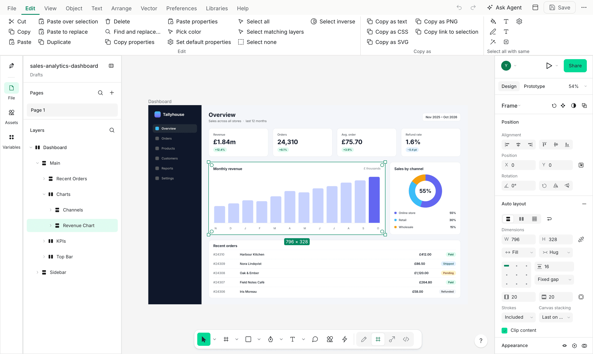
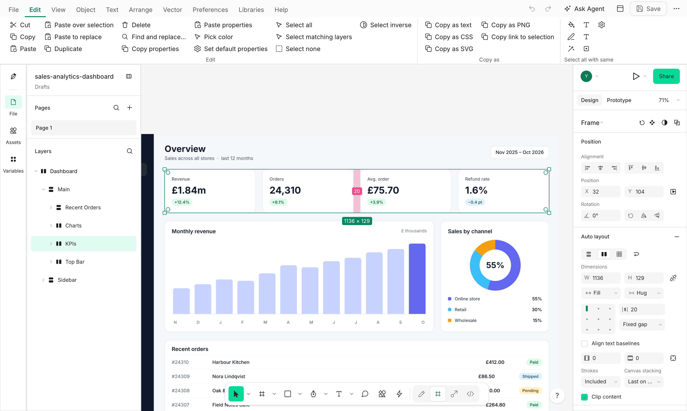
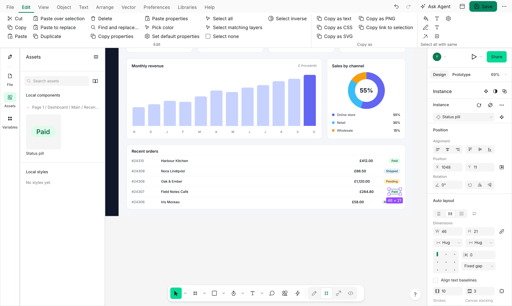
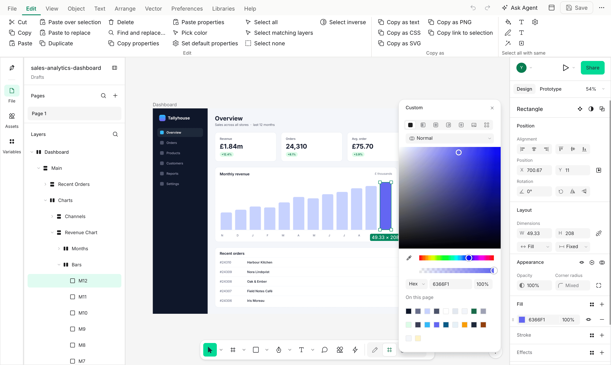
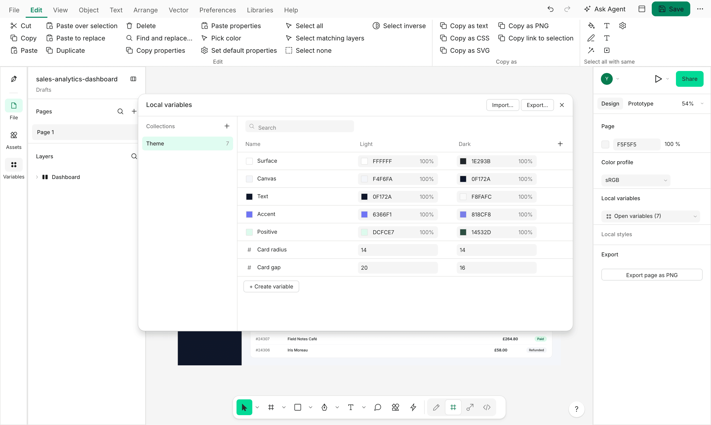
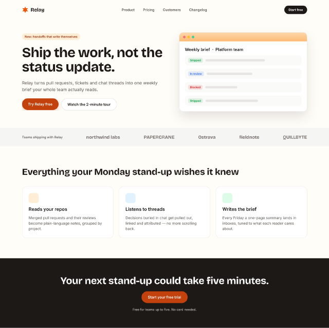
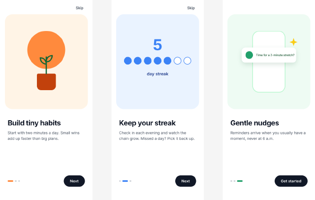
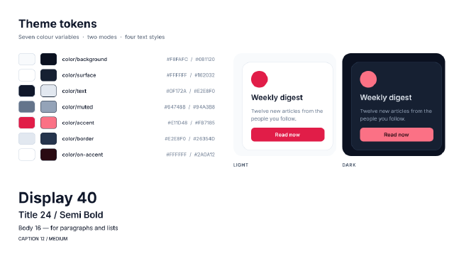
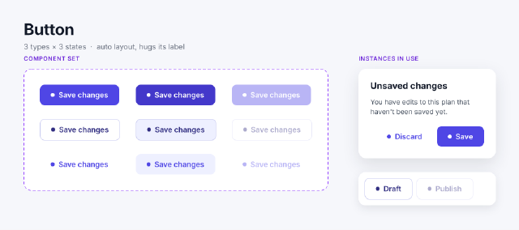

<div align="center">

# Kition Design

**Kition Design: an interface design editor, for people and AI agents**

Auto layout · Components · Styles and variables · Design checks · PNG, SVG and PDF export · MCP tools for agents

[](LICENSE)
[](https://www.npmjs.com/package/@kition/embed)
[](https://github.com/kitharness/kitharness)
[](bindings/wasm)

[Use it in Kition](https://kition.ai) · [Embed it](#embed-it-in-your-app) · [Give it to your agent](#give-it-to-your-agent) · [Showcase](https://github.com/KitionAI/kition-showcase/tree/main/design) · [Developer docs](https://developer.kition.ai) · [KHP](https://github.com/kitharness/kitharness)

</div>

Screen designs usually live in a closed format, inside one app. You can share a link, but you
can't open the file with anything else. An AI agent sees the design only as a picture: it can
describe a screen, but it can't move a card or fix a color.

Kition Design keeps a design in an open `.kdesign` file of pages, frames, auto layout, components,
styles and variables. The editor you work in and the tools an agent calls run the same Rust engine
and the same commands. So an agent can read the layers, set a gap or fix what the design check
found, and you see the change on the canvas. A write that rests on something you have since
changed is refused, not lost.



## What it does

### Why Design

- **Layouts that adjust themselves.** Auto layout stacks a frame's layers in a row or a column,
  hugs their content and spaces them evenly. Drag a padding or a gap on the canvas to change it.
- **Build once, reuse everywhere.** Make any layer a component and place instances of it. Each
  instance stays linked to its main component.
- **Styles and variables keep a design consistent.** Reuse fills and strokes as paint styles.
  Keep colors and sizes in variable collections with modes, such as Light and Dark, and bind them
  to layers.
- **Built for agents.** An agent reads the layers by id and edits them through the same commands as
  the editor. Each call reports exactly what changed, and the design check tells it what to fix.
- **A check that catches mistakes.** The check finds overflowing text, layers off the pixel grid,
  low contrast, and missing components, images, styles or variables.
- **Open source, in your page.** Apache-2.0, engine and editor. The engine is Rust, compiled to
  WebAssembly and run in a Web Worker, off your page's main thread.

### See it

<table>
<tr>
<td width="50%"><br /><b>Auto layout</b>: cards share a row's width; hover a gap or a padding and drag it.</td>
<td width="50%"><br /><b>Components and instances</b>: make a component, then place instances of it from Assets.</td>
</tr>
<tr>
<td width="50%"><br /><b>Fills and colors</b>: pick a color, or reuse one already on the page.</td>
<td width="50%"><br /><b>Variables with modes</b>: one value per mode, bound to fills, corners and gaps.</td>
</tr>
</table>

### Made with Design

<table>
<tr>
<td width="25%"><a href="https://github.com/KitionAI/kition-showcase/tree/main/design/saas-landing-page"></a></td>
<td width="25%"><a href="https://github.com/KitionAI/kition-showcase/tree/main/design/habit-app-onboarding-flow"></a></td>
<td width="25%"><a href="https://github.com/KitionAI/kition-showcase/tree/main/design/design-tokens-light-dark"></a></td>
<td width="25%"><a href="https://github.com/KitionAI/kition-showcase/tree/main/design/button-component-set"></a></td>
</tr>
</table>

Every sample is built with Design's own commands. [See all of them](https://github.com/KitionAI/kition-showcase/tree/main/design).

### Formats

| Opens | Creates | Exports |
| --- | --- | --- |
| `.kdesign`; `.fig`, `.sketch` (read-only) | `.kdesign` | `.png`, `.jpg`, `.svg`, `.pdf` |

Design edits and saves `.kdesign` files. A `.fig` or `.sketch` file opens read-only, as a
best-effort import: Design reads its pages, layers, auto layout, components, styles and
variables, and never writes over the file. The `.fig` import has been tested only on files built
for the tests.

## Quick start

### Use it in Kition

Open a `.kdesign` file in Kition and it opens in this editor. Kition's agent edits the same file
with the kit's `design_*` tools. [Download Kition](https://github.com/KitionAI/kition/releases/latest).

### Embed it in your app

Design's editor is a static package you host yourself, mounted into your page with the Kition
SDK's [`@kition/embed`](https://www.npmjs.com/package/@kition/embed). You keep the files and the
users; the editor reads and writes through the functions you give it.

1. Download `kition-design-<version>.tgz` from the
   [latest release](https://github.com/KitionAI/kition-design/releases/latest) and serve its
   `design-ui/` folder as static files on its own origin, with the headers in the
   [embed reference](https://github.com/KitionAI/kition-sdk/blob/main/docs/platform/reference/embed.md).
2. Install the SDK and mount the editor:

```sh
npm install @kition/embed
```

```ts
import { KitionEmbed } from '@kition/embed'

const editor = await KitionEmbed.mount(document.getElementById('design')!, {
  kit: { id: 'kit.design', url: 'https://kits.example.com/design-ui/' }, // the package you host
  file: { id: 'dashboard', name: 'Dashboard.kdesign' },
  storage: {
    read: async (id) => api.read(id),                    // { bytes, version }
    write: async (id, bytes, { expectedVersion }) =>     // refuse a stale version
      api.write(id, bytes, expectedVersion),             // { version }
  },
})
```

Every save carries the version it read, so an edit made elsewhere is never written over. The
[embed guide](https://github.com/KitionAI/kition-sdk/blob/main/docs/sdk/embed.md) covers identity,
checks and the rest.

### Give it to your agent

The engine also runs headless, and `kition`, the Kition SDK's command line, serves it as MCP tools
(`design_inspect`, `design_run`, `design_check`, `design_export`, ...) on a folder of designs, for
any MCP client. Nothing is compiled: you need neither Rust nor the Kition app. Install `kition`,
then connect your agent in the folder:

```sh
npm install -g @kition/cli        # Node.js 20 or later; gives the kition command
kition agent add claude           # or codex, cursor: registers kition's MCP server
```

Without installing it:
`claude mcp add kition -- npx -y @kition/cli mcp --workspace "$PWD"`. Without Node.js, install
`kition` with `curl -fsSL https://github.com/KitionAI/kition-sdk/releases/latest/download/install.sh | sh`
(Windows: `irm https://github.com/KitionAI/kition-sdk/releases/latest/download/install.ps1 | iex`)
and run the same `kition agent add`.

`kition` holds no kit. The first time the agent opens a `.kdesign` file, through the `kit_inspect`
tool the server offers until Design is installed, `kition` downloads Design's headless executable
into `~/.kition/kits` and the design tools appear. `kition kit install design` downloads it ahead of
time, and `kition kit upgrade` moves it to the newest version. Claude Desktop, Cursor, Codex and the
other commands are in the SDK's
[agent guide](https://github.com/KitionAI/kition-sdk/blob/main/docs/sdk/agent.md#connect-your-agent)
and [`kition` guide](https://github.com/KitionAI/kition-sdk/blob/main/docs/sdk/cli.md). To run a
build of your own (working on the kit itself), see
[docs/development.md](docs/development.md#build-and-test).

A real session on a copy of the dashboard sample, abridged. The agent raises the revenue figure
and widens the gap between the KPI cards:

```text
> design_inspect {"path":"dashboard.kdesign"}
Opened `dashboard.kdesign`: 3000 × 2000
{…,"details":{"kind":"design","layers":134,"name":"sales-analytics-dashboard",
  "pages":[{"id":1,"index":0,"layers":1,"name":"Page 1"}]},…,"revision":"ouo0",…}

> design_run {"path":"dashboard.kdesign","basis":"ouo0","steps":[
    {"command":"text.set","params":{"id":8087492137844769,"characters":"£1.91m"}},
    {"command":"node.set","params":{"id":8087492137844766,"props":{"gap":24}}}]}
Ran 2 commands on `dashboard.kdesign` (saved): 3000 × 2000 Changes: objects 6 changed.
{"changes":{"changed":[{"edits":[{"after":24,"before":20,"field":"layout.gap"}],…},
  {"edits":[{"after":266,"before":269,"field":"frame.width"},…],"id":8087492137844767,…},
  {"edits":[…,{"after":"£1.91m","before":"£1.84m","field":"kind.characters"},…],…},…],
  "created":[],"deleted":[],"moved":[]},…,"revision":"ouo1","saved":true}

> design_check {"path":"dashboard.kdesign","basis":"ouo1"}
Checked `dashboard.kdesign`: the kit found nothing wrong.

> design_export {"path":"dashboard.kdesign","to":"dashboard.png"}
Exported `dashboard.kdesign` as PNG to `dashboard.png` (140943 bytes).
```

The ids come from `design_inspect` with `target: {"pageId": 1}`, which lists the page's layers.
The receipt names every layer the run changed: the row's gap, the text, and the four cards that
auto layout narrowed to make room. The agent's guide is [agent/guide.md](agent/guide.md).

## Maturity

Preview: early, expect gaps. Version 0.1.2 · KHP 1.0, conformance level `agent-ready`. The level
describes how complete the interface for agents is; Preview describes how much of the editor is
there.

| Works today | Partly there | Not yet |
| --- | --- | --- |
| Frames, shapes and text | Prototyping: interactions and flows | Live sharing from the editor (the Share button is off; co-editing goes through Kition) |
| Auto layout that hugs its content | Dev Mode: inspect, code and measurements | Plug-ins, widgets and branches |
| Components and instances | Comments and version history | Spell check |
| Fills, strokes, shadows and paint styles | Vector editing and boolean operations | Video fills |
| Variables bound to properties | `.fig` and `.sketch` import | Checks against real-world `.fig` files |

Known gaps: [docs/gaps.md](docs/gaps.md). What's next: [docs/roadmap.md](docs/roadmap.md).

## Build and contribute

Build and test instructions are in [docs/development.md](docs/development.md). Read
[CONTRIBUTING.md](.github/CONTRIBUTING.md) before opening a pull request, and ask questions in
[Discussions](https://github.com/KitionAI/kition/discussions) or on [Discord](https://discord.gg/bFSjRDjVY).

## License

Apache-2.0 ([LICENSE](LICENSE)). Third-party licenses and notices are listed in [NOTICE](NOTICE)
and [docs/attribution.md](docs/attribution.md).

Portions of this kit are derived from a project licensed under the MIT License, used here under
that license and credited in [NOTICE](NOTICE).
